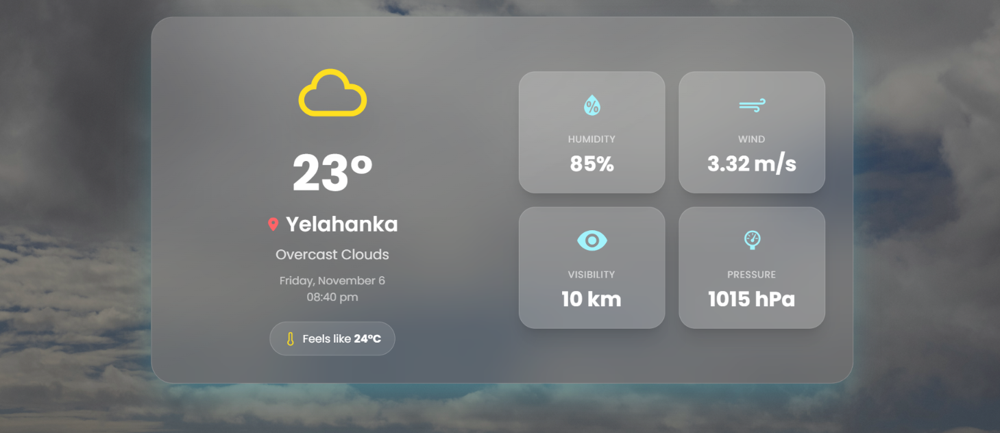
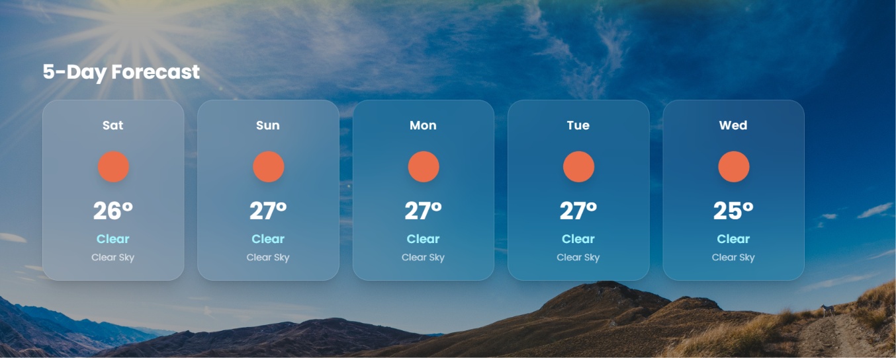
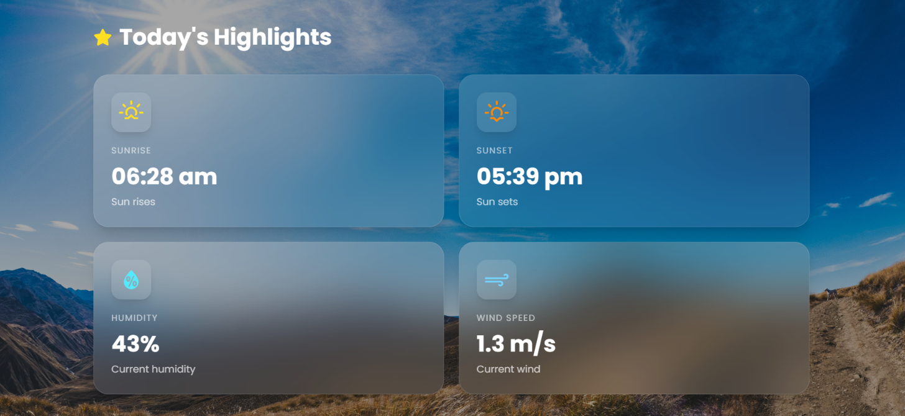

# 🌦️ Smart Weather App

A modern, responsive, full-stack weather application built with React and Node.js. It provides real-time weather information, location-based weather updates, 5-day forecasts, and detailed weather highlights through an interactive and visually appealing dashboard.

Search for any city or use your current location to explore weather conditions.

---

## 📸 Screenshots

### 🏠 Home Page


### 🌤️ Current Weather


### 📅 Weather Forecast


### 🌡️ Weather Highlights


---

## ✨ Features

- **City-Based Weather Search** – Search for weather information by city name.
- **Current Location Weather** – Get weather updates using your device's location.
- **Real-Time Weather Information** – View current temperature and weather conditions.
- **5-Day Weather Forecast** – Explore upcoming weather predictions.
- **Weather Highlights** – View important weather measurements and details.
- **Dynamic Weather Backgrounds** – Background themes change according to weather conditions.
- **Smooth Animations** – Interactive UI with smooth transitions and animations.
- **Responsive Design** – Optimized for different screen sizes.
- **Loading & Error Handling** – Provides feedback during API requests and when errors occur.

---

## 🛠️ Tech Stack

| Category | Technologies |
|---|---|
| Frontend | React 19, Vite |
| Styling | Tailwind CSS |
| Animations | Framer Motion |
| HTTP Client | Axios |
| Icons | React Icons |
| Backend | Node.js, Express.js |
| Weather API | OpenWeather API |
| Middleware | CORS, dotenv |

---

## 📂 Project Structure

```text
Weather-App/
│
├── backend/
│   ├── config/
│   ├── controllers/
│   ├── middleware/
│   ├── routes/
│   ├── services/
│   ├── utils/
│   ├── app.js
│   └── server.js
│
├── docs/
│   └── screenshots/
│       ├── current-weather.png
│       ├── forecast.png
│       ├── highlights.png
│       └── home.png
│
├── frontend/
│   ├── public/
│   ├── src/
│   │   ├── assets/
│   │   ├── components/
│   │   ├── pages/
│   │   ├── services/
│   │   └── utils/
│   └── package.json
│
├── .gitignore
├── package.json
├── package-lock.json
└── README.md
```

---

## ⚙️ Installation & Setup

Follow these steps to run the project locally.

### Prerequisites

Make sure you have installed:

- [Node.js](https://nodejs.org/)
- npm
- [Git](https://git-scm.com/)
- [OpenWeather API Key](https://openweathermap.org/api)

### 1. Clone the Repository

```bash
git clone https://github.com/iamshubham18/Smart-Weather-App.git

cd Smart-Weather-App
```

### 2. Install Dependencies

Install root dependencies:

```bash
npm install
```

Install backend dependencies:

```bash
cd backend
npm install
```

Install frontend dependencies in a separate terminal:

```bash
cd frontend
npm install
```

### 3. Configure Environment Variables

Create a `.env` file inside the `backend` directory.

**backend/.env**

```env
PORT=5000
OPENWEATHER_API_KEY=your_openweather_api_key
```

Create another `.env` file inside the `frontend` directory.

**frontend/.env**

```env
VITE_API_URL=http://localhost:5000
```

Replace the placeholder API key with your actual OpenWeather API key.

> **Security Note:** Never upload your actual API keys or `.env` files to GitHub. Keep environment files private and use `.env.example` files for documentation.

### 4. Start the Backend

Open a terminal:

```bash
cd backend
npm install
npm start
```

Backend runs at:

```text
http://localhost:5000
```

You can verify the backend using:

```text
http://localhost:5000/
```

Expected response:

```text
🚀 Smart Weather Backend is Running!
```

### 5. Start the Frontend

Open another terminal:

```bash
cd frontend
npm install
npm run dev
```

Open the local URL displayed in your terminal, usually:

```text
http://localhost:5173
```

---

## 🔌 API Endpoints

The backend provides the following REST API endpoints:

| Method | Endpoint | Description |
|---|---|---|
| GET | `/api/weather/:city` | Get current weather by city |
| GET | `/api/weather/location/current?lat={lat}&lon={lon}` | Get weather using coordinates |
| GET | `/api/forecast/:city` | Get 5-day forecast by city |
| GET | `/api/forecast/location/current?lat={lat}&lon={lon}` | Get forecast using coordinates |

### Example API Requests

**Current Weather:**

```http
GET http://localhost:5000/api/weather/Bangalore
```

**5-Day Forecast:**

```http
GET http://localhost:5000/api/forecast/Bangalore
```

**Weather by Coordinates:**

```http
GET http://localhost:5000/api/weather/location/current?lat=12.97&lon=77.59
```

---

## 🔄 How It Works

1. The user searches for a city or allows access to their current location.
2. The React frontend sends a request to the Node.js backend.
3. Express handles the API request through dedicated routes and controllers.
4. The backend fetches weather information from the OpenWeather API.
5. Weather data is formatted and returned to the frontend.
6. React displays current weather, forecasts, and weather highlights.

---

## 🚀 Future Improvements

- Add Celsius and Fahrenheit temperature conversion.
- Add favourite cities and saved locations.
- Improve API error handling and validation.
- Implement automated backend testing.
- Deploy the application for public access.

---

## 👨‍💻 Author

**Shubham Kumar Verma**

- GitHub: [@iamshubham18](https://github.com/iamshubham18)
- Project Repository: [Smart Weather App](https://github.com/iamshubham18/Smart-Weather-App)

---

⭐ If you like this project, consider giving it a star on GitHub!